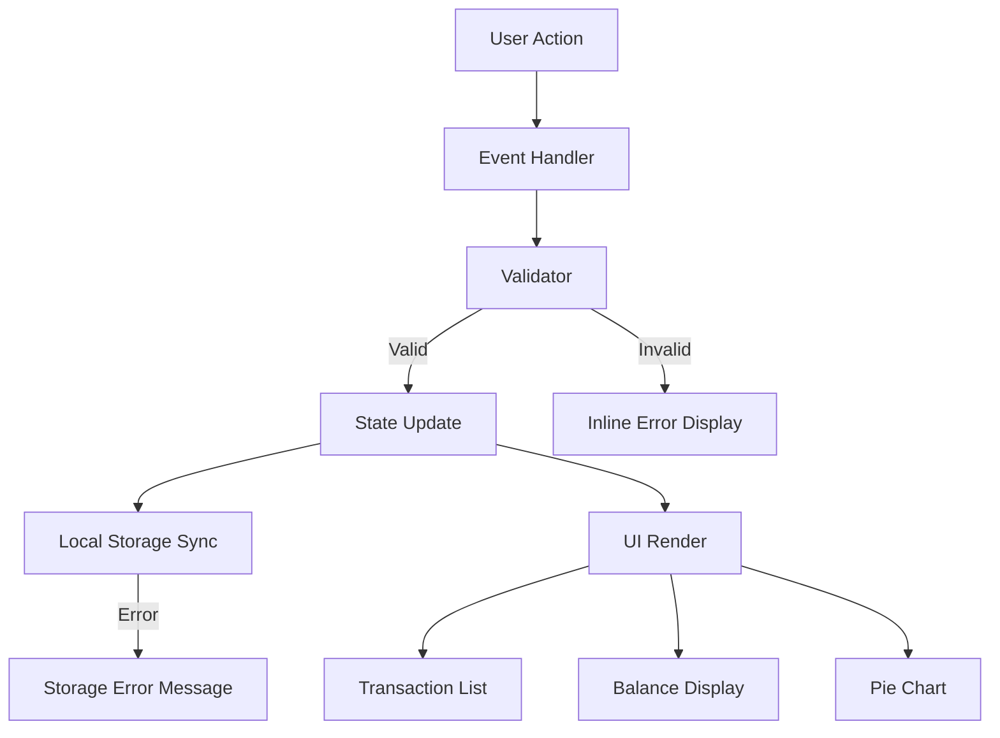

# Design Document

## Overview

The Expense & Budget Visualizer is a fully client-side single-page application (SPA) built with plain HTML, CSS, and Vanilla JavaScript. It allows users to log expenses by category, view a running total balance, and understand their spending distribution through a live pie chart. All data is persisted in the browser's Local Storage API — no server, build tool, or package manager is required.

The application is intentionally simple in architecture: one HTML file, one CSS file, and one JavaScript file, loadable by opening the HTML file directly in any modern browser. The only external dependency is [Chart.js](https://www.chartjs.org/) loaded from a CDN.

---

## Architecture

The app follows a **unidirectional data flow** pattern:

1. **User Action** (form submit, delete click) → triggers an event handler
2. **State Update** → modifies the in-memory transaction array and syncs to Local Storage
3. **UI Render** → all UI components (Transaction List, Balance Display, Pie Chart) are re-rendered from the updated state

This pattern ensures the UI is always a consistent reflection of the application state.



### File Structure

```
expense-budget-visualizer/
├── index.html          # App shell, markup, CDN script tags
├── css/
│   └── styles.css      # All styling
└── js/
    └── app.js          # All application logic
```

### Module Organization within `app.js`

Although the app uses a single JS file (no ES module bundler), the code is organized into clear logical sections using comments:

| Section | Responsibility |
|---|---|
| `// --- Constants` | Category colors, storage key, validation limits |
| `// --- State` | In-memory `transactions` array |
| `// --- Storage` | `loadFromStorage()`, `saveToStorage()` |
| `// --- Validator` | `validateForm(formData)` → `{valid, errors}` |
| `// --- State Mutations` | `addTransaction()`, `deleteTransaction()` |
| `// --- Renderers` | `renderAll()`, `renderList()`, `renderBalance()`, `renderChart()` |
| `// --- Event Handlers` | Form submit, delete button click |
| `// --- Init` | `init()` called on `DOMContentLoaded` |

---

## Components and Interfaces

### 1. Input Form (`#input-form`)

| Element | Type | Attributes |
|---|---|---|
| Item Name | `<input type="text">` | `maxlength="100"`, `required` |
| Amount | `<input type="number">` | `min="0.01"`, `max="999999999.99"`, `step="0.01"`, `required` |
| Category | `<select>` | Options: Food, Transport, Fun |
| Submit | `<button type="submit">` | Min 44×44 px touch target |

Each field has a sibling `<span class="field-error">` element that is shown/hidden by the Validator. On successful submission the form calls `form.reset()`.

### 2. Transaction List (`#transaction-list`)

A `<ul>` element rendered by `renderList()`. Each `<li>` contains:
- Item name, formatted amount, category badge
- A delete `<button>` with `data-id` attribute holding the transaction's ID

Renders a `<p class="empty-message">` when the list is empty.

### 3. Balance Display (`#balance-display`)

A `<span>` element updated by `renderBalance()` using `toFixed(2)`.

### 4. Pie Chart (`#chart-container` / `<canvas id="pie-chart">`)

Managed by a [Chart.js](https://www.chartjs.org/) `Chart` instance. The chart is created once on `init()` and updated via `chart.data = ...` + `chart.update()` on every state change. When no transactions exist the canvas is hidden and a placeholder `<p>` is shown instead.

---

## Data Models

### Transaction Object

```js
{
  id: string,        // crypto.randomUUID() — unique identifier
  name: string,      // item name, 1–100 characters
  amount: number,    // positive float, max 2 decimal places, range 0.01–999999999.99
  category: string,  // "Food" | "Transport" | "Fun"
  createdAt: string  // ISO 8601 timestamp (new Date().toISOString())
}
```

### Local Storage Schema

| Key | Value |
|---|---|
| `"expense_tracker_transactions"` | JSON-serialized array of Transaction objects |

Example:
```json
[
  {
    "id": "9b1deb4d-3b7d-4bad-9bdd-2b0d7b3dcb6d",
    "name": "Lunch",
    "amount": 12.50,
    "category": "Food",
    "createdAt": "2024-11-26T09:00:00.000Z"
  }
]
```

### Validation Rules

| Field | Rule |
|---|---|
| `name` | Non-empty after trimming whitespace, ≤ 100 characters |
| `amount` | Parseable as a number, ≥ 0.01, ≤ 999999999.99, at most 2 decimal places |
| `category` | One of `"Food"`, `"Transport"`, `"Fun"` |

### Category Color Map (fixed, per Requirement 4.5)

```js
const CATEGORY_COLORS = {
  Food:      "#FF6384",
  Transport: "#36A2EB",
  Fun:       "#FFCE56"
};
```

---

## Correctness Properties

*A property is a characteristic or behavior that should hold true across all valid executions of a system — essentially, a formal statement about what the system should do. Properties serve as the bridge between human-readable specifications and machine-verifiable correctness guarantees.*

### Property 1: Invalid inputs are always rejected with errors shown

*For any* input combination where at least one field is invalid — including an item name that is empty or composed purely of whitespace, an amount outside the range [0.01, 999999999.99] or with more than 2 decimal places, or a missing category selection — the Validator SHALL reject the submission, display inline error messages for each offending field, and leave the transaction list completely unchanged.

**Validates: Requirements 1.2, 1.3**

### Property 2: Valid transaction addition grows the list by exactly one

*For any* valid transaction (non-empty name after trimming, amount in [0.01, 999999999.99] with at most 2 decimal places, valid category), submitting it SHALL result in the transaction list length increasing by exactly one, and the new transaction SHALL appear at the head of the list.

**Validates: Requirements 1.4, 2.1**

### Property 3: Form resets to empty state after every valid submission

*For any* valid transaction submission, all form fields (item name, amount, category) SHALL be in their default empty state immediately after the transaction is added.

**Validates: Requirements 1.6**

### Property 4: Transaction list is always sorted newest-first

*For any* array of transactions with varying `createdAt` timestamps, the rendered Transaction List SHALL always display items in descending order of `createdAt`, such that the transaction with the most recent timestamp appears first.

**Validates: Requirements 2.1**

### Property 5: Storage restore on load produces the full original list

*For any* array of transactions written to Local Storage, initializing the app SHALL produce a Transaction List containing exactly the same transactions — same count, same field values — as were stored, with no entries added or omitted.

**Validates: Requirements 2.3, 5.3**

### Property 6: Delete removes exactly the targeted transaction

*For any* transaction list of length N and any transaction ID in that list, deleting that transaction by ID SHALL result in a list of length N−1 that contains all original transactions except the one with that ID, with no other modifications.

**Validates: Requirements 2.7**

### Property 7: Balance always equals the exact sum of transaction amounts

*For any* array of transactions, the value displayed by the Balance Display SHALL equal the sum of all `amount` fields in the array, formatted as a decimal string with exactly two decimal places.

**Validates: Requirements 3.1, 3.4**

### Property 8: Pie chart reflects only present categories with correct proportions

*For any* non-empty array of transactions, the chart data SHALL include a slice for every category that has at least one transaction and SHALL omit every category that has no transactions. Each present category's percentage SHALL equal `(categoryTotal / grandTotal) * 100` rounded to one decimal place, and the sum of all slice percentages SHALL equal 100% (within ±0.1 for floating-point rounding).

**Validates: Requirements 4.1, 4.6**

### Property 9: Serialization round-trip preserves all transaction data

*For any* array of Transaction objects, serializing the array to a JSON string and immediately deserializing it SHALL produce an array of objects that are deeply equal to the originals across all fields (`id`, `name`, `amount`, `category`, `createdAt`).

**Validates: Requirements 5.1, 5.2**

---

## Error Handling

| Scenario | Trigger | Recovery |
|---|---|---|
| Validation failure | Invalid/empty form fields | Inline error messages per field; form not submitted |
| Local Storage unavailable on write | `localStorage.setItem` throws | Show non-blocking error banner; do not add transaction to list |
| Local Storage unavailable on read | `localStorage.getItem` throws | Show error banner; initialize with empty state |
| Corrupted JSON in Local Storage | `JSON.parse` throws | Discard data; initialize with empty state; show error banner |
| Delete fails to persist | `localStorage.setItem` throws after delete | Show error banner; revert in-memory state; keep transaction visible |

All error messages are displayed in a `#error-banner` element that auto-dismisses after 5 seconds or can be manually closed.

Error handling follows a **fail-safe** strategy: if data cannot be persisted, the UI does not update (Requirement 1.5, 2.8). If data cannot be read, the app starts fresh rather than crashing (Requirement 5.5, 2.5).

---

## Testing Strategy

### Unit Tests (example-based)

Test framework: **Jest** (can be run with `npx jest` — no global install required).

Targeted test areas:

| Area | What to test |
|---|---|
| `validateForm` | Valid inputs pass; each invalid case (empty name, amount out of range, bad decimals, missing category) produces the correct error |
| `renderBalance` | 0 transactions → "0.00"; sum with pennies → correct 2-decimal output |
| `addTransaction` / `deleteTransaction` | State mutations produce correct new state arrays |
| `loadFromStorage` | Valid JSON → array; corrupted JSON → empty array + error flag; empty storage → empty array |
| `saveToStorage` | Serialized value matches expected JSON |
| Pie chart data builder | Category totals calculated correctly from a sample transaction array |

### Property-Based Tests (universal properties)

PBT library: **[fast-check](https://github.com/dubzzz/fast-check)** (CDN-available, or via `npx` for testing). Minimum **100 iterations per property**.

Each test is tagged with a comment in the format:
`// Feature: expense-budget-visualizer, Property N: <property text>`

| Property | Test description |
|---|---|
| **Property 1** | Generate invalid inputs (whitespace name, out-of-range amounts, missing category) → `validateForm` rejects all and returns field errors |
| **Property 2** | Generate valid transaction inputs → after `addTransaction`, list length increases by exactly 1 and new item is at index 0 |
| **Property 3** | Generate valid transaction inputs → after `addTransaction`, form state is fully empty |
| **Property 4** | Generate arbitrary arrays of transactions with varied timestamps → rendered order is always descending by `createdAt` |
| **Property 5** | Generate arbitrary Transaction arrays, write to storage, call `loadFromStorage` → returned array deep-equals original |
| **Property 6** | Generate a non-empty list and pick any transaction → after `deleteTransaction(id)`, that item is absent and all others remain unchanged |
| **Property 7** | Generate arbitrary non-empty transaction arrays → `calculateBalance` returns `sum.toFixed(2)` exactly |
| **Property 8** | Generate arbitrary non-empty transaction arrays → `buildChartData` percentages are correct per category, absent categories omitted, sum ≈ 100% |
| **Property 9** | Generate arbitrary Transaction arrays → `JSON.parse(JSON.stringify(arr))` deep-equals original across all fields |

### Integration / Smoke Tests

- App loads in a browser without JS errors (manual smoke test across Chrome, Firefox, Edge, Safari)
- Initial render completes within 3 seconds on a 10 Mbps connection (Chrome DevTools network throttle)
- Chart.js CDN script loads and `Chart` is defined before `init()` runs
- All interactive elements meet 44×44 px minimum touch target (browser DevTools audit)

### Accessibility

- All form inputs have associated `<label>` elements
- Error messages are linked to their fields via `aria-describedby`
- Color alone is not used as the only differentiator — category labels appear in both the list and the chart legend
- Minimum contrast ratios follow WCAG 2.1 AA (manual verification with a contrast checker)
